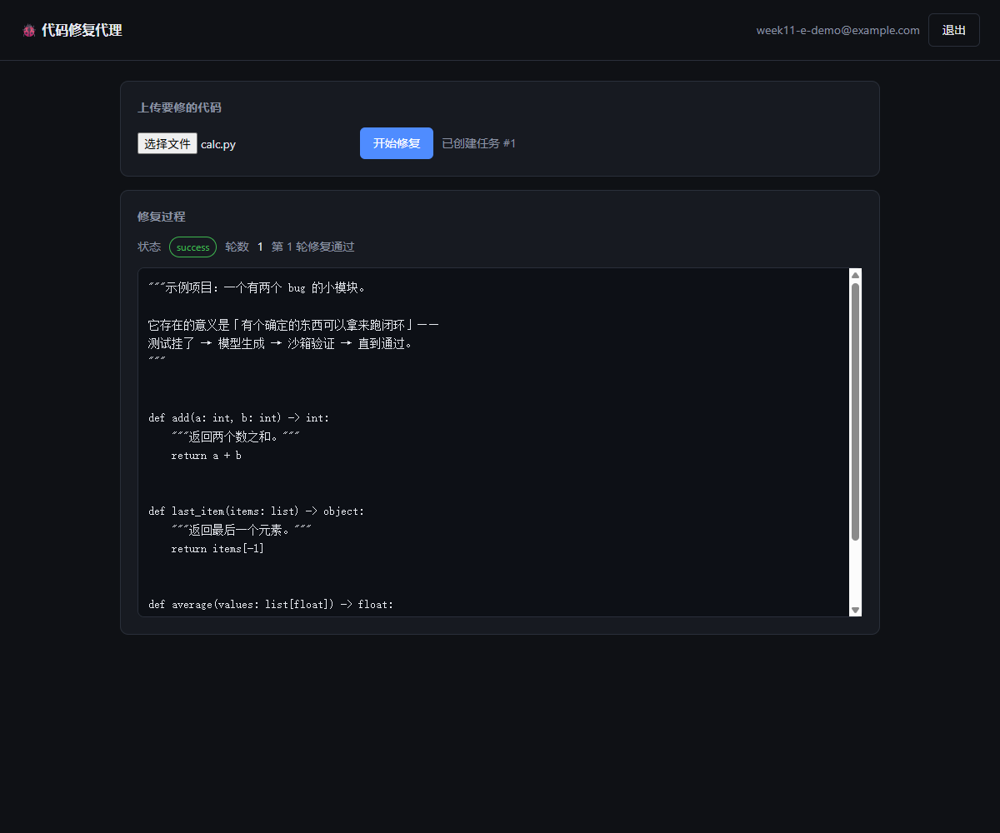
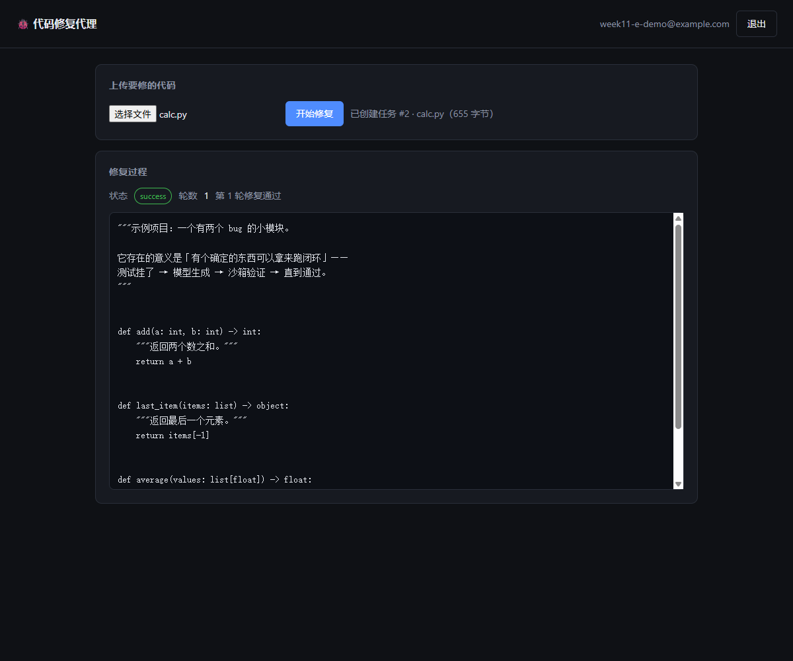

# Week 11 — 我做了什么

## 改了什么

- `frontend/index.html`（功能 commit 短 SHA：待提交后填写）。成功创建修复任务后，在任务编号旁显示上传的文件名和字节数。
- `course_evidence/E/week11/role_report.md`、`01-repair-success.png`、`02-upload-file-details.png`。记录浏览器实测过程和修改前后的截图。

## 实际跑了什么

用 Chrome 在本地打开页面，注册测试账号并上传 `examples/broken_project/calc.py`。前后两次均使用项目内置的演示模型和独立的临时数据库。脚本调用项目的 `run.py`，通过网页按钮提交文件，并额外以更短的间隔查询任务接口以记录中间状态。

手动复现时，在仓库根目录运行 `.\.venv\Scripts\python.exe run.py`，打开 `http://127.0.0.1:8000`，注册或登录，选择 `examples/broken_project/calc.py` 并点击「开始修复」。

以下是浏览器实测和既有测试的命令与输出。

```text
PS> node (Join-Path $env:TEMP 'course-e-week11-smoke.mjs')
INFO:     Started server process [24728]
INFO:     Waiting for application startup.
INFO:     Application startup complete.
INFO:     Uvicorn running on http://127.0.0.1:8000 (Press CTRL+C to quit)
INFO:     127.0.0.1:55296 - "GET /health HTTP/1.1" 200 OK
INFO:     127.0.0.1:63029 - "GET /?week11=before HTTP/1.1" 200 OK
INFO:     127.0.0.1:54201 - "GET /favicon.ico HTTP/1.1" 404 Not Found
INFO:     127.0.0.1:63029 - "POST /auth/register HTTP/1.1" 201 Created
INFO:     127.0.0.1:63029 - "POST /auth/login HTTP/1.1" 200 OK
INFO:     127.0.0.1:63029 - "GET /auth/me HTTP/1.1" 200 OK
INFO:     127.0.0.1:59954 - "POST /tasks HTTP/1.1" 201 Created
INFO:     127.0.0.1:59954 - "GET /tasks/1 HTTP/1.1" 200 OK
INFO:     127.0.0.1:59884 - "GET /tasks/1 HTTP/1.1" 200 OK
INFO:     127.0.0.1:59884 - "GET /tasks/1 HTTP/1.1" 200 OK
INFO:     127.0.0.1:59884 - "GET /tasks/1 HTTP/1.1" 200 OK
INFO:     127.0.0.1:59884 - "GET /tasks/1 HTTP/1.1" 200 OK
INFO:     127.0.0.1:59884 - "GET /tasks/1 HTTP/1.1" 200 OK
INFO:     127.0.0.1:59884 - "GET /tasks/1 HTTP/1.1" 200 OK
INFO:     127.0.0.1:59884 - "GET /tasks/1 HTTP/1.1" 200 OK
INFO:     127.0.0.1:59884 - "GET /tasks/1 HTTP/1.1" 200 OK
INFO:     127.0.0.1:59884 - "GET /tasks/1 HTTP/1.1" 200 OK
BEFORE statuses {"api":["pending","running","success"],"ui":["running","success"]}
BEFORE HTTP [["/auth/register",201],["/auth/login",200],["/auth/me",200],["/tasks",201,"pending"],["/tasks/1",200,"running"],["/tasks/1",200,"success"]]
BEFORE UI {"status":"success","upload":"已创建任务 #1","corrected":["return a + b","return items[-1]"]}
Saved 01-repair-success.png
INFO:     127.0.0.1:59884 - "GET /?week11=after HTTP/1.1" 200 OK
INFO:     127.0.0.1:59884 - "GET /auth/me HTTP/1.1" 200 OK
AFTER without a file: 先选一个 .py 文件
INFO:     127.0.0.1:59884 - "POST /tasks HTTP/1.1" 201 Created
INFO:     127.0.0.1:59954 - "GET /tasks/2 HTTP/1.1" 200 OK
INFO:     127.0.0.1:59884 - "GET /tasks/2 HTTP/1.1" 200 OK
INFO:     127.0.0.1:59884 - "GET /tasks/2 HTTP/1.1" 200 OK
INFO:     127.0.0.1:59884 - "GET /tasks/2 HTTP/1.1" 200 OK
INFO:     127.0.0.1:59884 - "GET /tasks/2 HTTP/1.1" 200 OK
INFO:     127.0.0.1:59884 - "GET /tasks/2 HTTP/1.1" 200 OK
INFO:     127.0.0.1:59884 - "GET /tasks/2 HTTP/1.1" 200 OK
INFO:     127.0.0.1:59884 - "GET /tasks/2 HTTP/1.1" 200 OK
INFO:     127.0.0.1:59884 - "GET /tasks/2 HTTP/1.1" 200 OK
AFTER statuses {"api":["pending","running","success"],"ui":["pending","success"]}
AFTER HTTP [["/auth/me",200],["/tasks",201,"pending"],["/tasks/2",200,"pending"],["/tasks/2",200,"success"]]
AFTER UI {"status":"success","upload":"已创建任务 #2 · calc.py（655 字节）","corrected":["return a + b","return items[-1]"]}
Saved 02-upload-file-details.png
```

```text
PS> .\.venv\Scripts\python.exe -m pytest tests -q
................................................                         [100%]
============================== warnings summary ===============================
tests/roles/a/test_auth_api.py::test_health
  D:\CS5351-Group01\.venv\Lib\site-packages\fastapi\testclient.py:1: StarletteDeprecationWarning: Using `httpx` with `starlette.testclient` is deprecated; install `httpx2` instead.
    from starlette.testclient import TestClient as TestClient  # noqa

-- Docs: https://docs.pytest.org/en/stable/how-to/capture-warnings.html
48 passed, 1 warning in 7.67s
```

提交前使用临时 Git tree 检查改动目录，4 个文件均通过本地所有权预检。

```text
PS> .\.venv\Scripts\python.exe tools/check_pr_ownership.py --base origin/main --head b1b1309e71a4d66bf3a376de853cc013c220ec04 --branch course/e
note: 角色 E 还没在 roles.json 里填 github，跳过提交人核对。
OWNERSHIP CHECK PASS role=e changed=4
```

## 结果

E_WEEK11_RESULT: PASS

- 两次均完成上传与修复，最终显示 `success`，结果区包含 `return a + b` 和 `return items[-1]`。
- 第二次上传显示 `calc.py（655 字节）`。未选择文件时点击「开始修复」，页面提示先选一个 `.py` 文件。
- 两次的任务接口都返回了 `pending → running → success`。页面每秒查询一次，短任务的中间状态可能跳过。修改前截图对应的实测页面显示了 `running → success`，修改后显示了 `pending → success`。
- 既有项目测试为 48 个通过，出现 1 条依赖弃用警告。仓库当前没有独立的 E 角色测试文件。

### 修改前后的截图





### 读前端后的三条改进想法

1. 给结果区的 Python 代码加语法高亮，方便读函数、注释和返回值。
2. 增加原代码与修复结果的差异视图，标出新增和删除的行，方便核对改动。
3. 上传时增加进度提示，把文件传输和后台修复分开显示，方便判断当前在等哪一步。

## 卡在哪

本地测试已通过。仓库还没有配置 Git 提交身份，访问 `github.com:443` 的 Git 请求也超时，代码与报告目前留在本地 `course/e`，待提交并推送后才能出现在 GitHub PR 中。
