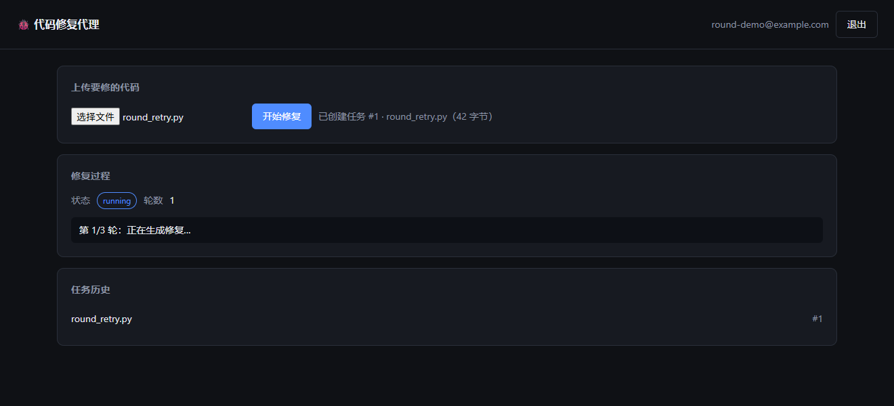

# Week 12 · 11-24 — E 修复轮次进度

## A + E 联调

- 前端每 400 毫秒轮询 `GET /tasks/{id}`，在「修复过程」中更新状态、轮数和后端返回的 `message`。创建新任务后立即显示排队状态，并停止轮询前一个任务。
- 验收用的临时副本基于 `59ae66c`，加入 A 的后端提交 `993787d` 和本次前端改动。

## 浏览器验收

使用项目内置的 FakeLLM，在 Chrome 上传下面的 `round_retry.py`。这个样例在导入时触发错误，能稳定触发重试。

```python
raise RuntimeError("round progress demo")
```

同一个任务在 `running` 状态下先显示轮数 **1** 和「第 1/3 轮：正在生成修复…」，随后显示轮数 **2** 和「第 2/3 轮：上一轮未通过，重新生成…」。3 轮结束后，页面显示 `failed` 和「3 轮内未能修复」。




另用本地测试模型接口返回两份固定候选，让首轮导入失败、第二轮通过。页面末态显示 `success`、轮数 **2** 和「第 2 轮修复通过」。另外，用内置 FakeLLM 上传 `examples/broken_project/calc.py` 时，第 1 轮成功，结果区仍显示 `return a + b`。

## 回归测试

在包含 A 改动的临时副本里，用项目 `.venv` 执行 `python -m pytest tests -q`。实际结果为 `92 passed, 1 warning`，警告来自 Starlette 测试客户端的依赖弃用提醒。
