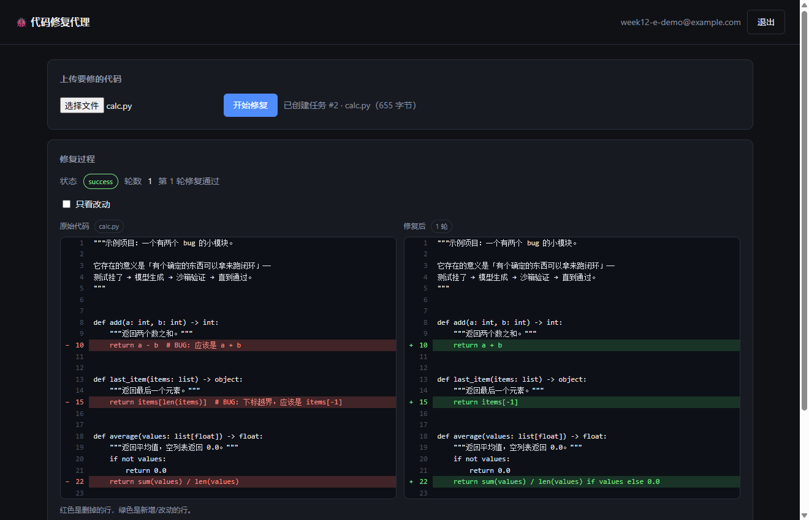
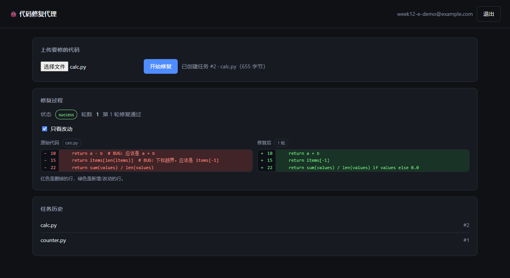

# Week 12 · Day 4 — E 前端界面收尾

## 改动

- 「只看改动」默认关闭。开启后隐藏未改动的行，保留增删内容和各自的原行号。相同内容会显示「没有改动」。超出对比计算上限时，仍可并排查看完整代码。
- 「任务历史」通过已登录账号的 `GET /tasks` 加载文件名和任务编号。登录、刷新页面或上传成功后会更新，最新任务排在最前面。
- 调亮深色界面上的红绿提示。对比行使用更亮的文字和对应的底色，并用 `−` 和 `+` 区分删除和新增。

## 实际验证

在临时数据库中启动本地服务，用 Chrome 操作网页，使用项目内置的演示模型。

1. 注册测试账号，依次上传 `examples/off_by_one/counter.py` 和 `examples/broken_project/calc.py`。两个任务都进入 `success`，任务历史先显示 `calc.py`（#2），再显示 `counter.py`（#1）。
2. 打开 `calc.py` 的修复对比。开启「只看改动」后，每侧的 20 行未改动内容都隐藏了，第 10、15、22 行的增删仍保留。第 10 行从 `return a - b` 修为 `return a + b`。关掉开关，全量对比恢复。
3. 从实际渲染的颜色计算，对比区红字与红底的对比度为 **6.13∶1**，绿字与绿底为 **8.86∶1**。
4. 登出后历史区清空并隐藏。第二个测试账号登录时显示空历史，切回原账号并刷新后仍能看到两条记录。
5. 验证相同内容和大文件两种情况。仅换行符格式不同时显示「没有改动」。对比超过计算上限时，禁用开关并保留两侧完整代码。

PowerShell 运行的已有测试命令

```powershell
.\.venv\Scripts\python.exe -m pytest tests -q
```

结果为 75 项通过，1 条 Starlette 依赖弃用警告。

## 验收截图

### 关闭「只看改动」



### 开启「只看改动」


